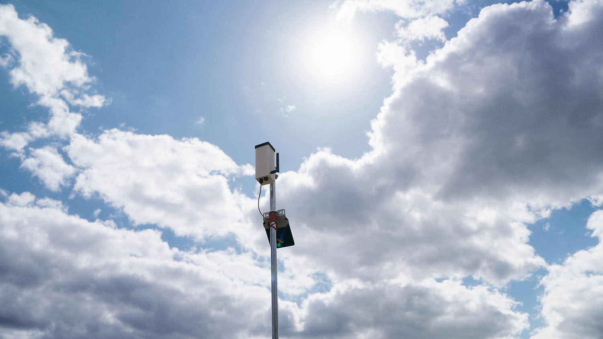

# Sunlight Colour Study

The sun's colours, gathered from many places into one view, moment by moment.

The light that leaves the sun is the same white for all of us. Everything that happens to its colour happens here: miles of air, cloud, dust, the haze over a city. All of it the same sun, met differently.

Small sensors on rooftops in different parts of the world read the colour of the daylight above them. For now there is one, in London, and the days gather on the project page as cells played in step, so one morning can be watched beside another.

You already know this light. It is the cool blue of an overcast day, the warmth of low sun, falling on you while your eye quietly edits it away. Alone, each colour is almost nothing. Together, their differences make each one visible, first as days, then as places.

A work in progress.

**[8minutes20.studio/sunlight-colour-study](https://8minutes20.studio/sunlight-colour-study)**

## Status

The three Wi-Fi units (`sensor-00`, `sensor-01` and `sensor-02`) are now shelved. `sensor-01` sent a day of colour from a London rooftop from 6 October 2026, and those days stay in the grid. The work has moved to the cellular version below.

Still to do: check the calibration against the reference meter under real sun.

## The cellular version

The Wi-Fi units limited a sensor to rooftops within reach of a usable network, and there are few of those. The cellular unit sends over the mobile network instead, through a Blues Notecard with a built-in global eSIM, so a sensor can go anywhere with a phone signal.

It is also built around a much smaller power budget:

- **A custom board** carries an ESP32-S3 microcontroller, with the charger, battery gauge and solar monitoring on the same small board. It sleeps between readings.
- **The radio sleeps.** Readings are queued on the unit and sent in batches, instead of holding a Wi-Fi connection open all day.
- **Four colour sensors per unit.** Each is calibrated against the reference, and their readings are blended into one.
- **All in one piece.** A small solar panel is built into the housing, so the whole unit goes up on a single mount.

A first unit is now the one feeding the London grid, on trial. It is not yet proven on battery and solar alone, and power figures remain estimates until it has been measured over a full run.

## How it works

Each unit is a solar-powered, hand-built sensor: an OPT4048 tristimulus colour sensor under a diffusing dome, read by an Adafruit QT Py ESP32-S2 and published over MQTT. The server adds tint (Duv), solar position and a per-unit calibration, and renders the measured chromaticity as true colour for the grid.

- [How it works](docs/how-it-works.md): hardware, the path from sensor to colour, and calibration.
- [The dome and UV](docs/dome-and-uv.md): how the original dome fluoresced in sunlight and pushed readings about 1,000K too blue, and the fix.

## This repository

Notes only: the write-ups in [`docs/`](docs/) and the images in `media/`. It holds no code.

## Contact

**Paul Calver** — [paulcalver@me.com](mailto:paulcalver@me.com)

Get in touch about putting a sensor on a roof somewhere the network does not yet reach, or about the project generally.

## Licence

The text and images are released under the MIT licence, see [LICENSE](LICENSE).
