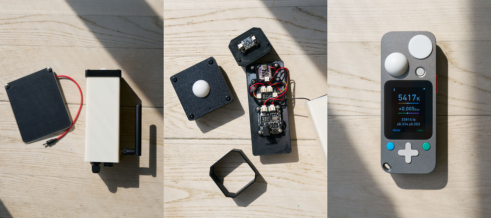

# How it works

Sensor to `hex`: what each reading goes through, and how separate units are checked against each other and against a physical reference.

## Hardware

There are two generations. The first, now shelved, is the Wi-Fi unit described here and in the sections below. The second, the cellular unit, is covered under [The cellular unit](#the-cellular-unit).

### Wi-Fi unit

Adafruit QT Py ESP32-S2, OPT4048 tristimulus colour sensor, Voltaic P126 solar panel (6V, 2W), 2000 mAh LiPo battery, BQ24074 charge controller, MQTT over Wi-Fi, custom 3D-printed enclosure. Each unit is designed and hand-built, running on solar power alone with no mains connection. The sensor measures the light itself, not the sky's appearance.

*Left: an assembled unit with its solar panel. Centre: the same unit opened out — dome and clamp ring, sensor deck, and the sled carrying the microcontroller, fuel gauge and charge controller. Right: the reference colour meter the units are calibrated against. This is the earlier flanged-dome build; the clamp ring and mixing tube are gone in the current revision.*

## Sensor

An `OPT4048` tristimulus colour sensor sits behind the dome and diffuser, reading four raw channels (`X`, `Y`, `Z`, and a clear `W` channel) once per publish cycle. Unlike an RGB camera sensor, these four channels are built to match the CIE 1931 colour-matching functions directly, so colour and level convert straight to standard colorimetric quantities, CIE `x, y` chromaticity and lux, without a lookup table in between.

## On the device

On the Wi-Fi unit, the microcontroller reads the sensor, takes its `x, y` chromaticity, and derives correlated colour temperature (CCT): the temperature of the blackbody radiator whose colour is the nearest match on the CIE diagram. `cct`, `lux`, `cie_x`, `cie_y`, the raw channel counts, a sensor-overload flag, and battery state are packaged as JSON and published over MQTT to a self-hosted broker. Readings it cannot send are kept on the device and published later, filed at the time they were taken, and it joins the strongest known Wi-Fi network in range.

## On the server

CCT alone collapses a two-dimensional colour to a single number along the blackbody curve, discarding the axis perpendicular to it: whether the light sits slightly green or slightly magenta of a true blackbody at that temperature. The server recovers that as **Duv**, computed from the stored `x, y` using the CIE 1960 UCS transform and a closed-form fit to the Planckian locus (Ohno, 2011), accurate to a few parts in 10⁻⁴ across the daylight range. Each reading is also stamped with the sensor's registered location and the sun's elevation and azimuth at that instant, so a colour can be read against time of day and season, not just in isolation. The server also averages readings into ten-minute samples, which is what the project page's grid is built from: one cell per London day, 06:00 to 20:00, each played from a flat first light colour as the day fills in.

## The cellular unit

The second generation changes how a unit is powered, connected and sensed. The principle is the same: measure the light itself, then turn its chromaticity into a colour.

- **Connection.** A Blues Notecard with a built-in global eSIM sends over the mobile network, so a unit does not depend on a Wi-Fi network being in range.
- **Board.** A custom board carries an ESP32-S3 microcontroller, the battery charger, a battery fuel gauge and solar monitoring. The unit sleeps between readings and wakes about once a minute.
- **Batched sending.** Readings are queued on the unit and sent together, filed at the time they were taken, so the radio is on briefly rather than all day.
- **Four sensors.** Each unit carries four OPT4048 sensors behind their own domes, read through a multiplexer. Each sensor is calibrated separately, and the server combines the four into a single blended reading for the grid.
- **Housing.** A small solar panel is built into the housing, so the whole unit goes up on a single mount.

The first cellular unit is on trial in London. It has not yet been shown to run on its battery and panel alone, so its power figures are estimates until measured over a full run.

## Colour you see

The colour in the daily grid and on the debug page is the sensor's measured chromaticity rendered as true colour, not a Kelvin-to-RGB approximation. `x, y` is converted to CIE XYZ at unit luminance, then to linear sRGB with the standard D65 primary matrix. Out-of-gamut negative values are clipped, and the result is normalised so the brightest channel reads full strength, brightness being deliberately discarded here, so the display is a pure colour comparison rather than an exposure match. sRGB gamma is applied and the three channels are rounded to 8 bits, giving the `hex` value.

## Calibration: computational

A correction is fitted per sensor (four on a cellular unit) against a trusted physical reference and applied at ingest, the same stage Duv is already computed at. Since the September 2026 recalibration it is a 3×3 matrix on the raw CIE `x, y`, not two separate adjustments in mireds and Duv: these sensors' colour-temperature and tint errors interact (their tint response grows at warm colour temperatures), which two independent corrections cannot model. Held-out tests on 21 reference points per unit predict colour temperature to about 30 to 55K on the blackbody locus and Duv to about 0.001, against 135 to 260K and 0.003 to 0.005 for the earlier pair. Each of the four sensors on the first cellular unit was fitted the same way, on 18 reference points each. Raw values are never overwritten: the calibrated columns sit alongside them, so a fit can be refined or redone as more reference data comes in without losing anything.

## Calibration: physical

That reference comes from a direct comparison indoors, before a unit goes outside. In September 2026 the three units were set under a rented colour-tunable studio light (an ARRI SkyPanel S30-C) and read against the Lit Duo 1 colour meter, stepping through the daylight range of colour temperatures and through green and magenta tints. Once the fit is established:

- one unit deploys to its site (`sensor-01`, on 6 October 2026, now shelved),
- another stays permanently on the bench as a fixed source of truth, and
- every future unit gets checked against that bench reference, rather than against the meter each time.

The reference unit is never itself installed outdoors, so its own drift stays out of the loop.

A check against the meter under real sun, which the studio light cannot stand in for, is still to be done. It is the test that shows whether the new optics have removed the UV error described in [The dome and UV](dome-and-uv.md) for good.
